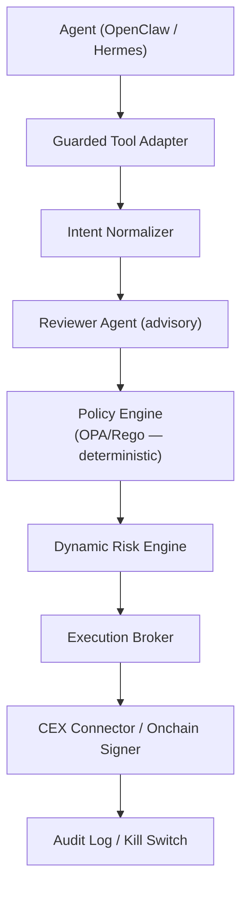

# Agent Trading Guardrails

A TypeScript-based guardrails framework that lets AI trading agents (OpenClaw, Hermes Agent) propose trading actions on centralized exchanges and onchain protocols while keeping execution, policy, secrets, signing, network access, and auditability outside the agent runtime.

## Scope

- **Supported agents:** OpenClaw, Hermes Agent
- **CEX:** Binance spot and USD-M futures
- **Onchain:** Ethereum Sepolia (testnet), Solana devnet
- **Policy engine:** OPA/Rego for deterministic authorization
- **Reviewer:** LLM-based semantic review (advisory, not authoritative)
- **Secrets:** Vault or a production-grade secret manager for live profiles, local provider for development
- **Audit:** Hash-chained SQLite audit records; tamper evidence depends on protecting `AUDIT_HASH_SECRET` and any configured external hash anchor

## Non-Goals

- The agent runtime does not hold CEX API keys, wallet private keys, or direct exchange/RPC access.
- The reviewer agent verdict is advisory — it cannot sign, trade, approve secrets, or bypass policy.
- This is not a general-purpose trading platform. It is a security boundary between AI agents and financial execution.
- Margin lending, cross-margin, and COIN-M futures are excluded from the first scope.
- CEX withdrawals and account transfers are always denied.

## Architecture



See [docs/architecture.md](docs/architecture.md) for details.

## Prerequisites

- Node.js >= 22
- pnpm (via Corepack: `corepack enable`)
- Docker (for OPA sidecar and local development)

## Getting Started

```bash
corepack enable
pnpm install
cp env.example .env

# Build workspace packages before running tests
pnpm build

# Run unit tests (excludes *.integration.test.ts)
pnpm test

# Run integration tests
pnpm test:integration

# Lint and typecheck
pnpm lint
pnpm typecheck
```

Both test suites fail if no matching test files are discovered. `pnpm run ci` runs lint,
typecheck, unit tests, and integration tests.

### Isolated local deployment

Set `OPENAI_API_KEY` in `.env` and configure the trusted risk snapshot described in
[Deployment Profiles](docs/deployment-profiles.md#runtime-configuration-and-risk-data).

```sh
mkdir -p data/risk
docker compose up --build -d --wait
node deploy/verify-local.mjs
docker compose exec -T agent node packages/agent-adapters/dist/main.js < intents.jsonl
```

The Linux Docker stack includes Agent, Guardrail, Broker, an offline Sepolia Signer, OPA, a
fixed-route egress proxy, and firewall/DNS helpers. Agent can reach only the guarded intent API:
direct exchange/RPC, metadata/private-network traffic, and external DNS are denied. DNS queries,
packet drops, and proxy access logs persist in named volumes. See
[deployment prerequisites and log operations](docs/deployment-profiles.md#local-docker-development).

Agent does not load `.env`, hold signing/reviewer secrets, or automatically execute decisions.
Host-only `pnpm start:service`, `pnpm start:broker`, and `pnpm start:agent` remain debugging tools,
but host processes do **not** inherit Compose's sandbox. Signer returns offline signed transactions;
it does not broadcast them, and generated local keys must never be funded.

The standalone broker defaults to **simulated dev/paper execution**. Explicit Binance configuration
enables signed REST execution on testnet or opt-in canary mainnet, plus exchange-backed market,
portfolio, and daily risk facts; see [Binance setup and accounting limits](docs/deployment-profiles.md#binance-rest-and-exchange-backed-risk).
Default Compose remains isolated file-risk/paper execution. The HTTP APIs are unauthenticated
development interfaces, loopback-published by default; use an authenticated gateway before remote
deployment. See the [HTTP contract](docs/deployment-profiles.md#http-contract)
for validation, correlation IDs, and startup configuration. Pending human approvals now persist
across Guardrail/Broker restarts in shared SQLite; operators use `pnpm start:approval -- list`
and `approve`/`deny` from a separate process. See the
[operator workflow and storage requirements](docs/deployment-profiles.md#cross-process-human-approval).

## Security

**Real API keys, wallet private keys, seed phrases, and other secrets must never be committed to this repository.** Use the `env.example` file as a template and store actual secrets in `.env` (gitignored) or a secret manager.

CI audits both production and development dependencies and fails on high or critical advisories.
Run these checks separately from `pnpm run ci`:

```sh
pnpm audit --audit-level=high --prod
pnpm audit --audit-level=high
```

Security patch pins are maintained in `pnpm-workspace.yaml` and `pnpm-lock.yaml`. When a patch
is newer than the seven-day release-age gate, add its exact version to `minimumReleaseAgeExclude`
rather than disabling the gate. A successful audit can still report lower-severity advisories.

See [docs/security-boundaries.md](docs/security-boundaries.md) for the full security model.
