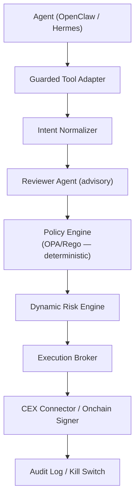

# Agent Trading Guardrails

A TypeScript-based guardrails framework that lets AI trading agents (OpenClaw, Hermes Agent) propose trading actions on centralized exchanges and onchain protocols while keeping execution, policy, secrets, signing, network access, and auditability outside the agent runtime.

## Scope

- **Supported agents:** OpenClaw, Hermes Agent
- **CEX:** Binance spot and USD-M futures
- **Onchain:** Ethereum Sepolia (testnet), Solana devnet
- **Policy engine:** OPA/Rego for deterministic authorization
- **Reviewer:** LLM-based semantic review (advisory, not authoritative)
- **Secrets:** Vault or a production-grade secret manager for live profiles, local provider for development
- **Audit:** Hash-chained SQLite audit records; tamper evidence depends on protecting `AUDIT_HASH_SECRET` and any configured external hash anchor

## Non-Goals

- The agent runtime does not hold CEX API keys, wallet private keys, or direct exchange/RPC access.
- The reviewer agent verdict is advisory — it cannot sign, trade, approve secrets, or bypass policy.
- This is not a general-purpose trading platform. It is a security boundary between AI agents and financial execution.
- Margin lending, cross-margin, and COIN-M futures are excluded from the first scope.
- CEX withdrawals and account transfers are always denied.

## Architecture



See [docs/architecture.md](docs/architecture.md) for details.

## Prerequisites

- Node.js >= 22
- pnpm (via Corepack: `corepack enable`)
- Docker (for OPA sidecar and local development)

## Getting Started

```bash
corepack enable
pnpm install
cp env.example .env

# Build workspace packages before running tests
pnpm build

# Run unit tests (excludes *.integration.test.ts)
pnpm test

# Run integration tests
pnpm test:integration

# Lint and typecheck
pnpm lint
pnpm typecheck
```

Both test suites fail if no matching test files are discovered. `pnpm run ci` runs lint,
typecheck, unit tests, and integration tests.

### Standalone services

Set `OPENAI_API_KEY` in `.env` and configure the trusted risk snapshot described in
[Deployment Profiles](docs/deployment-profiles.md#runtime-configuration-and-risk-data).

```sh
docker compose up -d opa
pnpm start:service  # terminal 1: GET /health, POST /evaluate on 127.0.0.1:3000
pnpm start:broker   # terminal 2: GET /health, POST /execute on 127.0.0.1:3001
```

Submit raw intent JSON Lines with `pnpm --silent start:agent < intents.jsonl`; the agent does not
load `.env`, hold signing/reviewer secrets, or automatically execute decisions. For containers,
use `docker compose up --build -d guardrail broker` and
`docker compose run --rm -T agent < intents.jsonl`.

The standalone broker performs **simulated execution in dev/paper only**. The HTTP APIs are
unauthenticated development interfaces, loopback-published by default; use an authenticated
gateway before remote deployment. See the [HTTP contract](docs/deployment-profiles.md#http-contract)
for validation, correlation IDs, approval limitations, and startup configuration.

## Security

**Real API keys, wallet private keys, seed phrases, and other secrets must never be committed to this repository.** Use the `env.example` file as a template and store actual secrets in `.env` (gitignored) or a secret manager.

CI audits both production and development dependencies and fails on high or critical advisories.
Run these checks separately from `pnpm run ci`:

```sh
pnpm audit --audit-level=high --prod
pnpm audit --audit-level=high
```

Security patch pins are maintained in `pnpm-workspace.yaml` and `pnpm-lock.yaml`. When a patch
is newer than the seven-day release-age gate, add its exact version to `minimumReleaseAgeExclude`
rather than disabling the gate. A successful audit can still report lower-severity advisories.

See [docs/security-boundaries.md](docs/security-boundaries.md) for the full security model.
