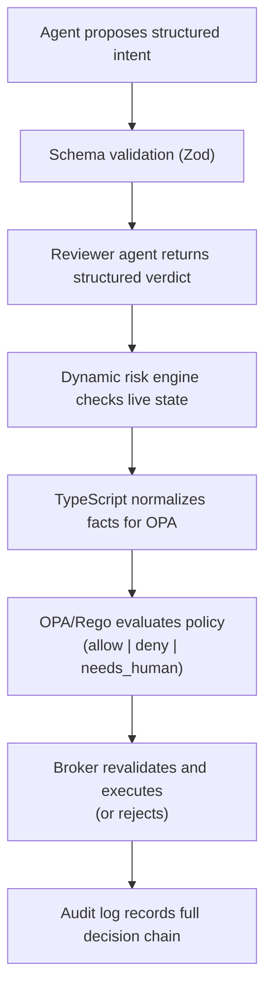

# Architecture

## Overview

The Agent Trading Guardrails framework uses a Sidecar Guardrail Service + Policy-as-Code + Execution Broker architecture. AI agents submit structured trading intents through a guarded tool adapter. Every intent passes through schema validation, semantic review, deterministic policy evaluation, dynamic risk checks, and broker-side revalidation before execution.

## Components

### Agent Adapter Layer

OpenClaw's native `registerTool` plugin and Hermes's Python `register(ctx)` plugin expose five
namespaced authorization tools. Both use the TypeScript adapters and `GuardrailEvaluateClient`
to submit schema-validated intents to remote `POST /evaluate`; neither embeds `GuardrailService`.
Hermes invokes a bundled Node bridge with a restricted environment. Principal, environment,
and service URL come from operator configuration, never tool arguments. The tools return
authorization decisions only: an allow is not an execution/simulation/signature result.
Installable standalone packages are built by `pnpm package:plugins`; see the
[framework installation guide](deployment-profiles.md#openclaw-and-hermes-runtime-plugins).

### Intent Normalizer

Accepts only structured requests. Validates required fields. Rejects ambiguous, free-form, or underspecified actions. Enforces canonical action names, asset normalization, evidence references, and idempotency keys.

### Reviewer Agent

Provides semantic review before policy evaluation. Detects suspicious reasoning, prompt injection, unsupported claims, risky behavior, and mismatch between evidence and proposed action. The reviewer verdict is advisory — it cannot sign, trade, approve secrets, or bypass policy.

`@guardrails/reviewer` exposes `Reviewer.review(intent)` and `createReviewer(config)` for
runtime selection. OpenAI chat uses the existing prompt/parser. Decision APIs use the
separate `DecisionProvider.decide({input, questions})` contract: named questions with fixed
string choices return a selected choice, probabilities and confidence. The HTTP adapter
supports TypeSafe Jev, Cloudflare-hosted Clef/Clef Flash and OpenAI Decisions without assuming
their transport envelopes are interchangeable.

`DecisionReviewerAdapter` asks eight independent questions in one request: the recommendation,
risk tier and each of the six detected-issue flags. It binds intent ID/provider/time locally,
records the returned model, and keeps the existing `ReviewerVerdictSchema`. Its reasons are
explicitly application-generated classification summaries, not invented model explanations;
`requiredPolicyTags` is empty because these APIs do not generate arbitrary tags. Missing,
refused, duplicate, malformed or unknown answers fail closed. Clef requests also fail closed
before dispatch if the full request exceeds a conservative hosted-context budget; the adapter
does not accept silent input truncation. An approve with detected issues is preserved for the
existing risk consistency veto, never silently converted into an allow.
There is no automatic provider fallback or cross-provider confidence threshold. See
[provider configuration and research sources](deployment-profiles.md#reviewer-providers).

### Policy Engine (OPA/Rego)

Final deterministic policy layer, evaluated after dynamic risk checks. Uses an IAM-inspired
model with principal, action, resource, condition, and effect:

1. Any hard deny rule rejects, regardless of reviewer approval.
2. Escalation rules require human approval, including non-low reviewer risk, a verdict other
   than approve, automatic thresholds, or no matching allowlist entry.
3. Automatic allow requires no hard deny/escalation, a matching allow rule, and approve/low
   from the reviewer. Broker-side revalidation remains independently required.

### Dynamic Risk Engine

Performs live data checks that are awkward to express in Rego: market data freshness, portfolio freshness, per-order notional, daily notional, daily loss, slippage, position delta, order frequency, and evidence reference validation.

### Execution Broker

The only component allowed to call CEX APIs or signing services. Revalidates state before execution. Enforces policy result. Handles idempotency, kill switch, and audit logging.

Standalone composition lives in `packages/runtime`. Guardrail exposes `GET /health` and
`POST /evaluate`; the broker exposes `GET /health` and `POST /execute`. The Agent JSONL
entrypoint and native framework plugins submit intents over HTTP but never execute automatically.
The standalone broker defaults to simulated `dev`/`paper` execution; explicit Binance configuration
selects testnet or opt-in canary execution. Risk data comes from an operator-owned file snapshot
or the exchange-backed Binance provider, never request-supplied market facts. Guardrail and
broker own separate audit chains, and broker idempotency is durable.

### Secret and Signing Boundary

CEX API keys live only in the broker or secret manager (Vault). Wallet private keys live only in the signer, KMS, HSM, or MPC system. The agent runtime never sees secrets.

### Network Proxy and Firewall

Constrains agent egress when deployed with the required runtime or container controls. Production-like deployments must allowlist LLM providers and the guardrail API while blocking CEX APIs, RPC endpoints, metadata services, and internal network ranges from agent containers.

### Audit Log

Hash-chained SQLite audit records. Tamper evidence depends on protecting `AUDIT_HASH_SECRET` and, outside dev/test, the configured external hash anchor. Records decision points such as intent receipt, reviewer verdicts, policy evaluation, risk checks, final decisions, broker revalidation, execution results, and human approval details.

## Data Flow

## Environment Profiles

| Profile | Execution Mode |
|---------|---------------|
| `dev` | Mock connectors, no real execution |
| `paper` | Simulated execution against live market data |
| `testnet` | Real testnet transactions (Sepolia, Solana devnet) |
| `canary_live` | Real execution with tight canary limits when explicitly enabled |
| `production` | Reserved/planned profile; broker execution currently rejects production |
